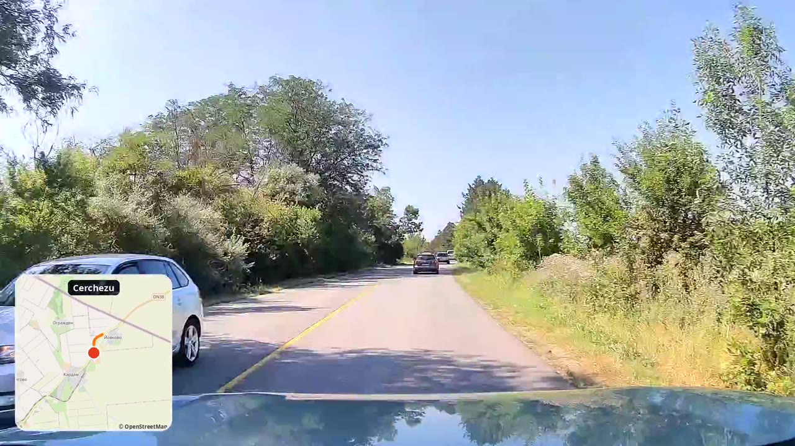

# dashcam-map-overlay

Add an animated GPS minimap to your dashcam video: the route, your current position and the direction of travel, drawn on OpenStreetMap.



## What works

| Source | Status |
|---|---|
| 70mai dashcam files | Reads the GPS embedded in the video. Tested on real 2592x1456 and 2592x1944 clips, northern/eastern hemisphere only. |
| Any camera + GPX track | Pass a track recorded by a phone app or GPS logger with `--gpx`. Tested on a generated track only. |
| Other embedded GPS formats | Not supported. Every brand stores GPS differently. Pull requests welcome. |

## Install

You need Python 3.9+ and [ffmpeg](https://ffmpeg.org/) (built with libass).

```bash
git clone https://github.com/sdmnc/dashcam-map-overlay
cd dashcam-map-overlay
python3 -m venv .venv
source .venv/bin/activate
pip install -r requirements.txt
```

## Try it without a dashcam

```bash
python3 examples/make_demo.py
python3 dashcam_map_overlay.py demo.mp4 --gpx demo.gpx --zoom 14 --title "Demo drive" -o demo_out.mp4
```

## Use it

70mai files, in driving order:

```bash
python3 dashcam_map_overlay.py clips/*.mp4 --zoom 12 --title "My trip" -o trip.mp4
```

Any other camera, with a GPX track. `--start` is when the first clip began, in UTC. If you leave it out, the video is assumed to start with the track, so check that the two line up.

```bash
python3 dashcam_map_overlay.py clips/*.mp4 --gpx trip.gpx --start 2026-07-15T10:09:44Z -o trip.mp4
```

An 8x hyperlapse with music and place names:

```bash
python3 dashcam_map_overlay.py clips/*.mp4 --speed 8 --audio music.mp3 --places cities500.txt -o fast.mp4
```

## Options

| Option | Meaning |
|---|---|
| `--zoom` | Map zoom: about 12 for highways, 14 for cities |
| `--speed` | Speed-up factor |
| `--title`, `--subtitle` | Text shown for the first few seconds |
| `--places` | [GeoNames](https://download.geonames.org/export/dump/) `cities500.txt`, to show place names (CC BY 4.0, credit GeoNames) |
| `--audio` | Soundtrack, looped. Without it the output is silent, so cabin conversations stay private |
| `--crop W:H:X:Y` | Your own crop. By default 70mai clips are cropped to hide the burned-in speed and coordinates, and other video is scaled to fill 1920x1080 |
| `--map-size` | Minimap size in pixels |
| `--work DIR` | Keep segments in `DIR`, so an interrupted render can resume. Use a new folder if you change options |
| `--tile-url`, `--attribution` | Use another map provider |

Output is always 1920x1080 at 30 fps.

## How it works

1. Reads one GPS position per second from the video files or the GPX track.
2. Downloads and caches the map tiles around the route, then draws the route on them.
3. Draws a minimap frame for each moment and pipes the frames to ffmpeg, which overlays them on the video.

## Maps and privacy

- **Keep the map credit.** OpenStreetMap data requires attribution, which the tool draws on the minimap by default.
- **Don't overload the free tile server.** The default server has a [usage policy](https://operations.osmfoundation.org/policies/tiles/) and isn't meant for bulk downloads. The tool caches tiles, downloads them slowly and stops above 500 tiles. For long or frequent renders, use another provider with `--tile-url`.
- **Be careful with your location.** Trim the start and end of drives before publishing, because a route on screen can reveal your home or workplace. Footage and GPS tracks are ignored by `.gitignore`.

## License

MIT. Map data © OpenStreetMap contributors. Written with help from Claude.
